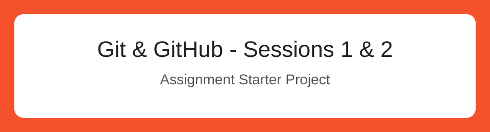

# Git & GitHub Fundamentals



## Student Information
- **Name:** Mohammed Youssef Chafiki
- **GitHub:** [youssef-dev-lab](https://github.com/youssef-dev-lab)

## Project Description
This project demonstrates Git and GitHub fundamentals, including commits, branches, merging, and synchronization.

## Technologies
- Git
- GitHub
- Markdown
- Terminal

## Example Git Commands
```bash
git status
git add README.md
git commit -m "Update project README"
```

## Useful Link
[Git Documentation](https://git-scm.com/doc)

This change was made directly on GitHub to demonstrate fetch and pull.
Unstaged diff demonstration.
